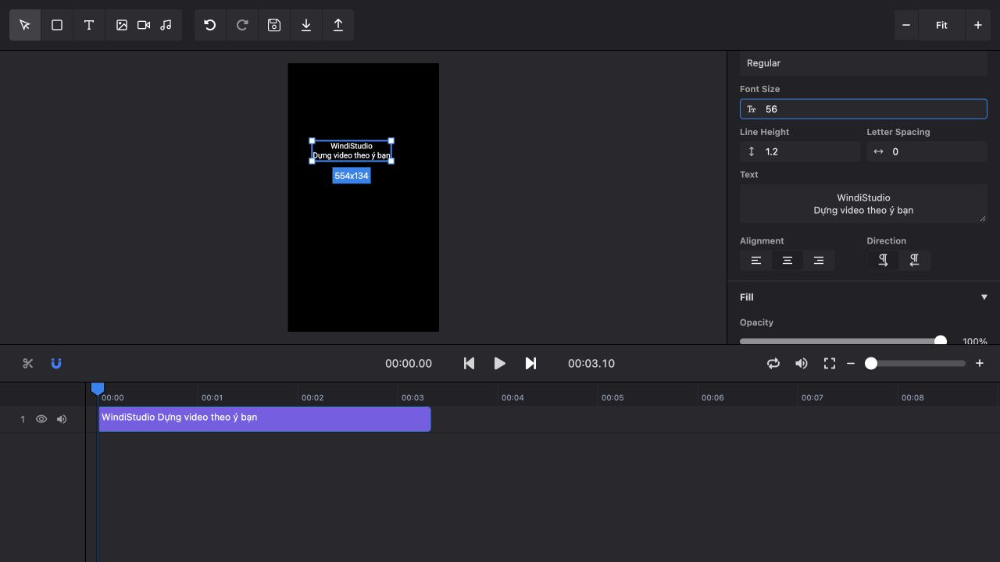

# Editor video trực quan cho WindiStudio

Ngày đối chiếu: **10/10/2026**. Phạm vi: nghiên cứu công cụ, đọc source editor hiện có, kiểm tra tài liệu/license chính thức và thử thao tác text trên demo Remotion. Đây là đề xuất kiến trúc; chưa tích hợp một editor mới hoặc kiểm chứng preview/export của các SDK với video WindiStudio.

## Đề xuất

**Giữ Remotion làm bộ dựng và phát triển editor quanh composition hiện có.** Có hai cách phù hợp:

- **Nâng editor Windi hiện có** nếu ưu tiên bảo toàn workflow, chủ động giao diện và khả năng bán source do mình viết. Thêm lớp dữ liệu layout/layer, thao tác trên canvas, audio tracks và preset chuyển cảnh.
- **Remotion Editor Starter** nếu ưu tiên có sẵn nhiều thao tác của phần mềm dựng phim và bán quyền sử dụng app. Giá công bố **600 USD cho một project**. Cần phát triển adapter cho scene Windi, Calling Code, transitions, keyframes và lưu dự án.

Đánh giá về độ phù hợp là nhận định kỹ thuật dựa trên source và tài liệu, chưa phải benchmark hoặc xác nhận từ nhà cung cấp. Starter giúp giảm phần UI phải xây; nó không tự biến mọi file TSX thành các layer chỉnh được.

## Workspace hiện có gì?

Đã chạy Graphify để định vị code, sau đó đọc trực tiếp các file liên quan:

- `kits/video-starter/editor/App.tsx:170`: preview bằng Remotion Player, truyền `editor` document vào `EpisodeComposition`.
- `kits/video-starter/editor/server.mjs:106`: export đăng ký component lấy từ cùng `editor.config.json`; render dùng snapshot document đã lưu.
- `kits/video-starter/editor/types.ts:3`: document hiện tổ chức theo beat, chứa headline, category, spoken pill, timing và media override.
- `videos/windistudio-repo/ws25-esp32-adblock/src/EditorComposition.tsx`: grid/floating motion và các component scene vẫn dựng bằng Remotion; nhiều thông số layout như vị trí và cỡ headline còn hardcode.
- `kits/windistudio-repo-video/references/timeline-editor.md`: editor nội bộ, tách khỏi web và gói khách hàng.

Khoảng thiếu chính: model chưa có text/layer tự do, thuộc tính layout tổng quát, keyframe tracks, transition objects, audio clips có trim/fade độc lập. UI hiện chỉnh nội dung chữ, biên cảnh, crop/zoom media và hệ số âm lượng; chưa thể chọn bất kỳ chữ/cửa sổ nào trên preview để kéo và resize.

**Dùng chung component cho preview/export là nền tảng tốt, nhưng chưa chứng minh giống bản dựng gốc ở mọi tập.** Adapter riêng, font, media, frame timing, 3D và audio vẫn cần kiểm tra. Các kết quả QA cũ trong workspace được đọc như tài liệu lịch sử; không chạy lại trong lượt nghiên cứu này.

## Các lựa chọn đáng cân nhắc

### 1. Remotion Editor Starter — phù hợp nhất nếu mua nền editor

Có timeline nhiều track, canvas tương tác, chọn/kéo/resize layer, inspector, crop, waveform, volume/fade, text và captions, undo/redo. Có thể bổ sung item type cho scene template của Windi. Preview/export nhận state JSON qua các API Remotion.

**Phần phải làm:** transitions và keyframes chưa có sẵn; autosave, quản lý nhiều project, auth và hỗ trợ điện thoại cũng chưa có. Calling Code cần tích hợp font riêng cho cả preview/render. Scene Windi custom cần expose props hoặc đăng ký thành item có schema.

**Giấy phép:** 600 USD/project; được tùy biến và tích hợp vào sản phẩm cho end user. Không được phân phối lại source hoặc đưa source starter vào bộ source bán cho khách. License Remotion nền tảng vẫn áp dụng riêng. Với app desktop phân phối, cần đối chiếu điều khoản theo hình thức đóng gói cụ thể trước khi bán.

Nguồn: [Tính năng](https://www.remotion.dev/docs/editor-starter/features), [Phần chưa có](https://www.remotion.dev/docs/editor-starter/features-not-included), [Cách dùng cùng Remotion](https://www.remotion.dev/docs/editor-starter/faq), [Giá](https://www.remotion.pro/store/editor-starter), [License riêng](https://www.remotion.pro/store/editor-starter?tab=license).

**Kiểm tra trực tiếp:** mở demo chính thức, vẽ text box, nhập “WindiStudio / Dựng video theo ý bạn”, đổi cỡ chữ từ 80 xuống 56. Canvas, inspector và tên clip timeline phản ánh thay đổi. Chưa thử import media, audio hoặc export trên demo.



Demo: [editor-starter.remotion.dev](https://editor-starter.remotion.dev/). Ảnh là giao diện demo của nhà cung cấp.

### 2. Tự phát triển trên Remotion + các component MIT — phù hợp nhất để giữ quyền bán source của phần tự viết

Các công cụ có thể giảm công xây UI:

| Công cụ | Vai trò | Giới hạn |
|---|---|---|
| [React Moveable](https://github.com/daybrush/moveable) | Tay nắm kéo, resize, rotate, snapping cho layer DOM/SVG; có bản React | Cần quy đổi tọa độ canvas thu phóng về 1080×1920 và ghi thay đổi vào document |
| [React Timeline Editor](https://github.com/xzdarcy/react-timeline-editor) | Component timeline animation có hàng và khoảng thời gian | Chỉ là khối UI; phải tự nối với playhead/frame, media trim, audio, transitions và undo |
| [Remotion Timeline](https://www.remotion.pro/store/timeline) | Timeline đồng bộ Player, ví dụ React/Vite, nhiều track | 300 USD; license thương mại riêng, không phải lựa chọn MIT |
| [@remotion/transitions](https://www.remotion.dev/docs/transitions) | Bộ chuyển cảnh dùng cùng renderer | Cần tự xây picker, timing và hành vi trên timeline; thuộc Remotion License |

Moveable và React Timeline Editor công bố [MIT](https://github.com/daybrush/moveable/blob/master/LICENSE) và [MIT](https://github.com/xzdarcy/react-timeline-editor/blob/master/LICENSE). Giữ notice tương ứng khi phân phối. Việc dùng chúng không thay đổi điều kiện license của Remotion và các dependency khác.

**Lựa chọn ban đầu:** dùng editor hiện có + Moveable, rồi đánh giá timeline hiện tại có thể mở rộng được bao xa. Chưa nên mua/thay toàn bộ timeline trước khi chốt layer model và thử một scene Windi thực tế. React Timeline Editor là ứng viên cần thử tương thích với phiên bản React của editor trước khi chốt dependency.

### 3. OpenCut — tham khảo UX và code có license MIT, chưa chọn làm nền thay Remotion

Repo chính hiện thông báo viết lại từ đầu với Rust core; Editor API, plugins, MCP và headless là hướng đang phát triển. Bản chạy tại opencut.app thuộc classic; repo classic đã archive và thông báo không còn được bảo trì.

License MIT cho phép sửa/phân phối/bán code với notice. Tuy nhiên, scene React/Remotion của Windi không tự trở thành scene native của OpenCut. Viết adapter chuyển sang engine khác làm tăng công bảo toàn grid, font, animation và 3D. Khuyến nghị dùng để tham khảo timeline/inspector/shortcut, theo dõi rewrite; không thay renderer production ở giai đoạn này.

Nguồn: [Trạng thái repo chính](https://github.com/OpenCut-app/OpenCut/blob/main/README.md), [Classic](https://github.com/OpenCut-app/opencut-classic/blob/main/README.md), [MIT license](https://github.com/OpenCut-app/OpenCut/blob/main/LICENSE).

### 4. WebCut — lựa chọn MIT cho sản phẩm dựng web từ đầu

[tangshuang/webcut](https://github.com/tangshuang/webcut) có canvas, timeline, text overlay, transform và control theo frame. Dùng Vue 3/Naive UI và WebAV, license MIT. Phù hợp để khảo sát nếu xây editor với engine web riêng; độ phù hợp thấp hơn với composition React/Remotion hiện có vì phải làm thêm cầu nối hoặc viết lại scene.

Chưa kiểm chứng độ mượt, transition coverage hoặc khả năng xuất video Windi. Không nhầm với repo WebCut khác có tên tương tự.

Nguồn: [README](https://github.com/tangshuang/webcut/blob/main/README.md), [License](https://github.com/tangshuang/webcut/blob/main/LICENSE).

### 5. IMG.LY CE.SDK — phương án thương mại có nhà cung cấp hỗ trợ

SDK tích hợp video editor, có UI tùy biến hoặc dùng engine với UI tự xây; có render phía client và server. Nhà cung cấp công bố hỗ trợ white-label/OEM; giá hiện yêu cầu báo giá, có trial 30 ngày.

Phù hợp khi ưu tiên mua SDK và support. Đây là engine khác; giữ nguyên React composition Windi vẫn là bài toán chuyển đổi. Chưa có báo giá cho WindiStudio hoặc kiểm tra tích hợp. Trang pricing và trang sản phẩm mô tả cơ chế tính phí khác nhau, nên không tự giả định một đơn giá theo MAU.

Nguồn: [Sản phẩm](https://img.ly/products/creative-sdk/), [Tùy biến UI](https://support.img.ly/can-i-customize-build-the-ui-in-ce-sdk-editor), [Pricing/trial/OEM](https://img.ly/pricing/).

## Các repo cần xử lý license trước khi chọn cho sản phẩm bán

| Repo/công cụ | Điều đã kiểm tra | Kết luận cho Windi |
|---|---|---|
| [OpenVideo, trước đây designcombo/react-video-editor](https://github.com/openvideodev/react-video-editor) | README hiện dùng PixiJS/WebCodecs; license có điều khoản cấm bán/cho thuê/cấp phép bản phái sinh | Không chọn mặc định cho editor đem bán dựa vào nhãn “free commercial”; cần quyền cụ thể từ tác giả |
| [Twick](https://github.com/ncounterspecialist/twick) | Sustainable Use License, cấm rebrand và hosted SaaS nếu chưa có commercial agreement; sản phẩm cạnh tranh cũng cần commercial license | Có SDK React đáng khảo sát, nhưng phải có thỏa thuận phù hợp trước khi thương mại hóa |
| [Kimu, trước đây robinroy03/videoeditor](https://github.com/trykimu/videoeditor) | Dual license AGPLv3/commercial; README có Remotion renderer và nhiều tính năng editor | Có thể cân nhắc theo AGPL nếu chấp nhận nghĩa vụ source tương ứng; sản phẩm đóng source cần commercial license |
| [RVE Pro](https://www.reactvideoeditor.com/products/pro) | Trang bán hiện niêm yết Startup 499 USD và cho commercial products; PDF license công khai điều 8.2 lại hạn chế SaaS/white-label và đưa source vào công cụ AI | Chưa đề xuất mua cho workflow Codex cho đến khi nhà cung cấp xác nhận văn bản license hiện áp dụng; các nguồn công khai chưa thống nhất |

Nguồn điều khoản: [OpenVideo LICENSE](https://github.com/openvideodev/react-video-editor/blob/main/LICENSE), [Twick LICENSE](https://github.com/ncounterspecialist/twick/blob/main/LICENSE.md), [Kimu LICENSE](https://github.com/trykimu/videoeditor/blob/main/LICENSE.md), [RVE PDF điều 8.2](https://www.reactvideoeditor.com/rve-full-license-agreement.pdf). Đây là đối chiếu điều khoản công bố phục vụ lựa chọn kỹ thuật; chưa có hợp đồng riêng với nhà cung cấp nào.

## Giao diện nên xây cho Windi

Định hướng sản phẩm: **AI dựng bản đầu, người dùng hoàn thiện bằng timeline và canvas.** Vibe retro dark thể hiện ở vỏ editor, còn preview hiển thị đúng preset video đang chọn.

- **Bên trái:** media, text presets, templates, transitions; thêm danh sách layer để chọn chữ khó click hoặc đang bị che.
- **Ở giữa:** preview 9:16 đủ lớn để đọc caption; fit/100%/phóng to; safe zones TikTok và guide căn lề có thể bật/tắt.
- **Bên phải:** inspector theo item đang chọn; nội dung, font/cỡ/line-height/màu, X/Y/W/H, crop, animation, audio. Có “áp dụng cho cảnh này / toàn bộ video” và “khôi phục preset”.
- **Phía dưới:** track scene, text/overlay, captions, voice, BGM và SFX. Scrub, split/trim, snapping, lock/mute, waveform, marker lời đọc và handles cho transition.
- **Thanh trên:** tên project, undo/redo, trạng thái autosave, lịch sử phiên bản và “Xuất video”.

Màu đề xuất: charcoal/navy, mint cho selection, cream cho chrome của cửa sổ retro. Giữ Calling Code; cần kiểm tra quyền nhúng/phân phối font nếu đóng gói bán. Grid nhẹ ở vùng nền trống, chữ điều khiển rõ và tương phản, tránh scanline/noise chạy trên toàn bộ vùng đọc. Giao diện desktop ưu tiên; tablet cần bố cục panel thu gọn và control dễ chạm.

## Kiến trúc để giảm render lại

```text
Workflow Windi tạo script / voice / timestamps / assets
                        ↓
Project document: scene + layout + layers + audio + transitions
                        ↓
              Cùng một Windi Composition
                  ↙                 ↘
          Remotion Player     Snapshot → Remotion Renderer
```

Các quyết định cần chốt khi triển khai:

1. **Scene phải có hợp đồng chỉnh sửa.** Scene code/3D đăng ký type, schema, default props và các vùng chọn được. Editor chỉnh dữ liệu props; không tự đoán toàn bộ layout từ TSX. Component scene vẫn dựng native bằng Remotion.
2. **Layer là dữ liệu thật.** Mỗi item có id, timing bằng frame, vị trí, kích thước, z-order, style, asset, animation. Tách layout mặc định của template và override theo cảnh. Chỉnh headline/caption phải tác động vào layer đang render.
3. **Tọa độ xuất là nguồn chuẩn.** UI thu phóng chỉ đổi cách nhìn. Kéo 20px trên preview phải quy đổi đúng về tọa độ composition. Selection handles chỉ hiện trong editor, không đi vào video.
4. **Animation chạy theo frame.** Preset text/window/3D đọc frame và dữ liệu; preview và render dùng cùng cách tính. Không dùng animation UI chạy theo đồng hồ để giả lập chuyển động video.
5. **Transitions cần giữ narration đúng mốc.** `TransitionSeries.Transition` tạo overlap và rút ngắn thời lượng. Với voice cố định, phải tính lại scene handles/timing hoặc dùng overlay tại cut point cho hiệu ứng phù hợp. HUD, watermark và caption đặt ở root nếu cần hiển thị liên tục. [Quy tắc duration của Remotion](https://www.remotion.dev/docs/transitions/transitionseries).
6. **Âm thanh chỉnh được theo clip.** Voice/BGM/SFX có trim, offset, gain dB, fade và mute; playback nghe đúng mix. Volume multiplier đơn lẻ không chứng minh loudness cuối. Sửa phụ đề không tự đổi lời đọc.
7. **Tìm lỗi ngay trong editor.** Báo thiếu font/media, chữ bị overflow, asset quá ngắn sau trim và vùng ngoài safe zone. Preview vẫn cần nghe/xem thật; giao diện đẹp không bảo đảm render đạt QA.
8. **Export lấy revision cố định.** Chụp snapshot document, assets và cấu hình renderer; thay đổi tiếp theo không lọt vào job đang chạy. Lưu project revision cùng kết quả để biết chính xác video xuất từ bản nào.

Preset chuyển cảnh ban đầu nên nhỏ: cut, fade, slide, wipe, cộng vài hiệu ứng Windi tự viết như retro window close/open và scan reveal. Các hiệu ứng custom là đề xuất; chưa tồn tại trong editor hiện tại. Chỉ dùng API có trong phiên bản Remotion đã pin, không lấy ví dụ docs mới rồi giả định tất cả đều chạy trên runtime cũ.

## Cách đưa thành sản phẩm

**Sản phẩm có điểm khác biệt:** editor hoàn thiện video AI đã dựng sẵn, có brand templates và caption tiếng Việt. Người dùng đi từ bản nháp đến video xuất trong cùng workflow. Đây là giả thuyết định vị cần pilot với khách thật; chưa phải bằng chứng có nhu cầu trả tiền.

Lộ trình theo kết quả kiểm chứng:

1. **Bản nội bộ:** một tập có sẵn, text/layout kéo trực tiếp, music replacement + gain/fade, một transition; chứng minh giữ grid, Calling và animation gốc. Có undo/autosave/reload.
2. **Pilot:** vài template và video thực tế; thử caption tiếng Việt dài, media khác tỷ lệ, audio/SFX, sửa toàn bộ video và sửa từng cảnh. Ghi số lần sửa sau export, thời gian hoàn thiện và lỗi người dùng gặp.
3. **Bản bán:** chọn rõ app hosted, app desktop hay source kit; hoàn thiện project portability, onboarding, asset/font rights, storage và hạn mức render nếu có cloud. Giá bán phải dựa trên support, storage, compute và dịch vụ voice/media thực tế.

**Điều kiện thương mại quan trọng:**

- Remotion hiện cho cá nhân/tổ chức đủ điều kiện tối đa 3 người dùng Free License, kể cả automation/SaaS. Tổ chức không đủ điều kiện cần Company License. Automators niêm yết **0,01 USD/render, tối thiểu 100 USD/tháng**, chưa gồm compute/storage/provider. Preview Player không tính là render. [Pricing](https://www.remotion.pro/license), [FAQ](https://www.remotion.dev/docs/license/faq).
- Starter mua riêng, không thay license Remotion. Nếu bán source/kit, tránh nhúng source starter; dùng UI tự viết hoặc thỏa thuận khác.
- SaaS dùng template của dịch vụ hoặc code do dịch vụ AI tạo được FAQ Remotion cho phép. Nhận bất kỳ project Remotion do khách tải lên để render là trường hợp FAQ không cho phép theo điều khoản thông thường. Vì vậy cần thiết kế chức năng import phù hợp với mô hình bán. [Allowed use cases](https://www.remotion.dev/docs/license/faq#what-kind-of-commercial-use-is-allowed).
- App chạy local có thể giảm chi phí server render, nhưng người dùng vẫn chịu tài nguyên máy và điều kiện license tương ứng. Render nhanh/máy mát hơn phải benchmark, chưa thể kết luận từ việc đổi UI.

## Phạm vi xác minh trong lượt này

- Đọc source của editor Windi và một adapter episode; đọc docs/license chính thức của các lựa chọn.
- Thử tạo text tiếng Việt và thay cỡ chữ trong demo Remotion; có ảnh minh chứng kèm theo.
- Chưa cài dependency mới, sửa composition, tạo asset/voice, chạy MP4 export, mua license hoặc phát hành sản phẩm.
- Chưa benchmark hiệu năng browser/M1 hoặc làm kiểm tra bảo mật/độ ổn định các repo bên ngoài. Các tính năng ngoài thao tác demo được mô tả theo tài liệu nhà cung cấp.

**Quyết định khuyến nghị:** bắt đầu bằng một thử nghiệm nhỏ trên editor Windi hiện có để chứng minh model layout/layer và khả năng giữ composition. Nếu chọn bán quyền dùng app và cần rút ngắn phần xây UI, Editor Starter là ứng viên mua phù hợp nhất sau khi thử model đó. Nếu bán source kit, ưu tiên UI tự viết + các component MIT và giữ Remotion theo license của nó.
